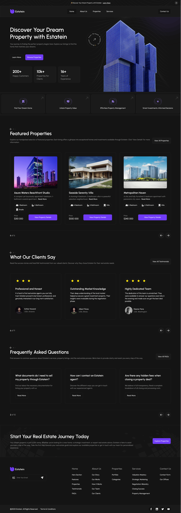
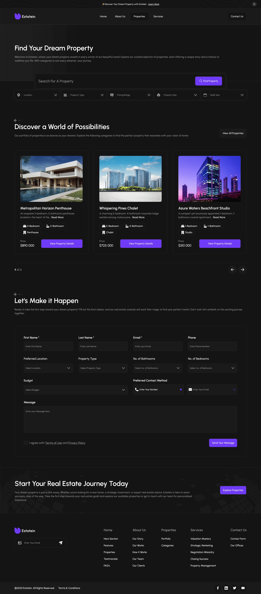
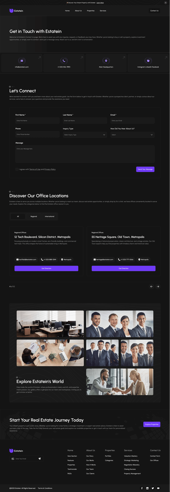

# Estatein — многостраничный сайт агентства недвижимости

Шестой учебный проект — сайт агентства недвижимости Estatein: семь страниц, от главной до карточки объекта. Первый многостраничный и первый компонентный проект: разметка собирается из JSX-секций и компонентов с пропсами, сборка — Vite + статический генератор Minista, весь контент вынесен в `data.js`. Сторонние библиотеки — Swiper, Choices.js и IMask, остальной интерактив — vanilla JS.

**[Открыть демо](https://ggadjiev.github.io/Estatein/)**

## Страницы сайта

- **Главная** — Hero с заголовком, двумя CTA-кнопками и статистикой агентства (200+ клиентов, 10k+ объектов, 16+ лет опыта); сетка из четырёх направлений работы; слайдер Featured Properties; отзывы клиентов со звёздным рейтингом; FAQ.

---
- **About Us** — история агентства, четыре ценности, достижения, процесс покупки из шести шагов, команда из четырёх сотрудников, клиенты-компании с отзывами.

---
- **Services** — две сетки услуг («Unlock Property Value» и «Effortless Property Management») с широкими CTA-карточками и инвестиционный блок.

---
- **Properties** — панель поиска: текстовое поле и пять фильтров-селектов (локация, тип недвижимости, цена, площадь, год постройки); слайдер объектов; форма подбора.

---
- **Property** — карточка объекта с ценой и адресом, детали (спальни, ванные, площадь), форма запроса и FAQ.

---
- **Contact** — четыре контактные карточки, форма связи, офисы с фильтром по табам (все / региональные / международные) и фотогалерея.

---
- **404** — страница ошибки с кнопкой возврата на главную.

Общее для всех страниц: закрываемый промо-бар, шапка с навигацией и бургер-меню, CTA-блок с формой подписки перед подвалом, подвал с якорной навигацией по секциям каждой страницы и соцсетями.

## Технологии

| Технология | Как используется |
| --- | --- |
| **Minista + Vite** | Статическая генерация: JSX-компоненты рендерятся в HTML на этапе сборки — React в браузер не попадает, сайту нужен только бандл с vanilla JS |
| **JSX** | Компонентная разметка: страницы собираются из секций, секции — из компонентов; контент передаётся пропсами из `data.js` |
| **SCSS** | 55 файлов (~4100 строк); helpers (`fluid()`, миксины брейкпоинтов) подключаются во все файлы автоматически через `additionalData`; дизайн-токены — кастомные свойства в `:root` |
| **CSS3** | Grid и Flexbox, флюид-типографика на `clamp()`, `aspect-ratio`, логические свойства |
| **Swiper 12** | Web components `swiper-container`: слайдеры объектов, отзывов, FAQ и офисов; автопрокрутка раз в 3 секунды с паузой при наведении, зацикливание, адаптивные брейкпоинты |
| **Choices.js** | Стилизованные селекты: пять фильтров поиска и поля форм |
| **IMask** | Маска ввода номера телефона |
| **Vanilla JS** | 7 модулей клиентской логики, которые находят свои элементы по `data-js-*`-атрибутам |
| **clsx** | Условные классы в компонентах |
| **Шрифт** | Urbanist (Regular / Medium / SemiBold / Bold, `woff2`) — локально |
| **PostCSS** | `pxtorem` и `preset-env` — только в production-сборке |
| **Качество кода** | ESLint 9 (flat config, `jsx-a11y`, `react-hooks`), Stylelint (БЭМ-паттерн селекторов, порядок свойств), Prettier |

## Интерактивность

Клиентская логика — отдельные модули vanilla JS, каждый сам находит свои элементы по `data-js-*`-атрибутам и не завязан на классы стилей:

- **Оверлей-меню** — бургер на мобильных: блокировка скролла страницы, закрытие по Escape и клику в фон.
- **Двойной слайдер объекта** — девять миниатюр под основным слайдером; активный слайд синхронизируется через модуль thumbs, инициализация web-компонентов ожидается через `requestAnimationFrame`.
- **Фильтрация офисов** — табы «все / региональные / международные» пересобирают слайдер: Swiper уничтожается, слайды фильтруются по классам, слайдер создаётся заново.
- **TextSlicer** — обрезка длинных описаний объектов по границе слов со ссылкой Read More.
- **Промо-бар** — закрывается по крестику.

## Архитектура

Код разделён на слои по ответственности:

- `pages/` — 7 страниц: только композиция секций и метаданные;
- `sections/` — 22 крупные секции, из которых собираются страницы;
- `components/` — 17 переиспользуемых компонентов: `Card` работает в трёх режимах (обычная / шаг / широкая), `Form` — в трёх конфигурациях (Properties / Contact / Property), `Slider` — обёртка над Swiper с пропсами;
- `layouts/` — 7 обёрток: шапка, подвал, промо-бар, `Section` и `SliderSection` с шапкой секции;
- `modules/` — 7 модулей клиентской логики;
- `constants/data.js` — весь контент сайта: объекты, отзывы, FAQ, команда, фильтры, формы;
- `utils/` — `link()` для ссылок с учётом базового пути GitHub Pages и мелкие помощники.

## Адаптивность

Вёрстка рассчитана на экраны от 350px до 1920px:

| Контрольная точка | Ширина |
| --- | --- |
| Laptop | ≤ 1440px |
| Tablet | ≤ 1024px |
| Mobile | ≤ 768px |
| Mobile-S | ≤ 480px |

Между точками размеры плавные: SCSS-функция `fluid($max, $min, $start, $end)` компилируется в `clamp()`, для типовых диапазонов 1920→1440 и 1440→390 есть готовые варианты `fluid-to-laptop()` и `fluid-laptop-to-mobile()`. Миксин `hover` различает устройства с мышью и без: на тач-экранах вместо `:hover` срабатывает `:active`.

## Чему я научился

- строить компонентную архитектуру: страницы → секции → компоненты; переиспользовать одну карточку в трёх режимах вместо копирования разметки;
- выносить весь контент в `data.js` и передавать его пропсами;
- подключать сторонние библиотеки и подгонять их под макет: Swiper, Choices.js, IMask;
- синхронизировать два слайдера между собой и пересоздавать Swiper после фильтрации слайдов;
- деплоить собранный проект в подпапку GitHub Pages: `base: '/Estatein/'` и утилита `link()` для корректных путей.

## Запуск локально

```bash
git clone https://github.com/GGadjiev/Estatein.git
cd Estatein
npm install
npm start        # дев-сервер с горячей перезагрузкой
npm run build    # production-сборка в dist/
npm run preview  # предпросмотр собранной версии
```

Проверка кода: `npm run lint` (ESLint + Stylelint + Prettier).

## Структура проекта

```
├── minista.config.js        # SSG-конфиг: base, SVG-спрайт, оптимизация изображений
├── postcss.config.js        # pxtorem + preset-env (production)
├── eslint.config.js         # ESLint 9: flat config, jsx-a11y, react-hooks
├── stylelint.config.js      # Stylelint: БЭМ-паттерн селекторов
├── prettier.config.js
└── src/
    ├── global.jsx           # каркас страниц: Head, PromoBar, Header, Footer
    ├── main.js              # входной бандл: инициализация JS-модулей
    ├── pages/               # 7 страниц: index, about, services, properties, property, contact, 404
    ├── sections/            # 22 секции
    ├── components/          # 17 компонентов: Button, Card, Field, Form, Select, Slider…
    ├── layouts/             # Header, Footer, PromoBar, Section, SliderSection…
    ├── modules/             # 7 модулей: OverlayMenu, InitSelect, InputMaskCollection…
    ├── constants/           # data.js — контент сайта
    ├── utils/               # link, getIdFromTitle, pxToRem…
    ├── styles/              # variables, globals, utils, fonts + helpers (media, mixins, functions)
    └── assets/              # Urbanist (woff2), 44 SVG-иконки, изображения
```

## Деплой

Production-сборка из `dist/` публикуется в ветку `gh-pages`. Проект живёт в подпапке `https://ggadjiev.github.io/Estatein/`, поэтому в конфиге задан `base: '/Estatein/'`, а все внутренние ссылки строятся утилитой `link()` из `import.meta.env.BASE_URL`.
